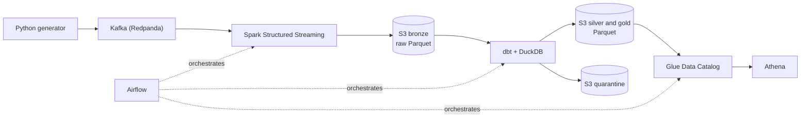

# sme-finance-lakehouse

A local data platform for a fictional small-business accounting scenario, built on a
medallion architecture (bronze, silver, gold) over S3-compatible object storage.
Storage and compute are decoupled, so each can scale on its own as a company grows.
Kafka, Spark and Parquet are used even though the data volume is small: the goal is to
show how these tools work, where their bottlenecks are, and when they are not worth it.
dbt handles the transformations. No cloud account: AWS services are emulated locally with Floci.

**Work in progress**: built module by module (see [Progress](#progress)).

## Architecture (planned)



| Layer | Tool | Role |
|---|---|---|
| Events | Python generator | Fictional invoices and payments, with known anomalies and a manifest to check against |
| Streaming | Kafka API, served by Redpanda | Decouples producers from consumers; events can be replayed |
| Ingestion | Spark Structured Streaming | Kafka to bronze, with checkpoints to resume without loss |
| Storage | S3 + Parquet (emulated by Floci) | Cheap storage, separate from compute; columnar reads |
| Transformations | dbt with DuckDB | Tested, documented SQL models: silver (clean data) and gold (star schema) |
| Consumption | Glue Data Catalog + Athena (emulated by Floci) | Analysts query tables, not file paths |
| Orchestration | Airflow | Dependencies, retries, replay by date |

S3, Glue and Athena are emulated by Floci. Redpanda replaces Floci's own Kafka service (MSK),
whose broker did not survive restarts. See [ADR 0001](docs/adr/0001-floci.md).

### Data lake layout

```text
s3://sme-lake/
├── bronze/        raw events from Kafka, unchanged (topic=<topic>/ingestion_date=<date>/)
├── silver/        cleaned, typed and deduplicated data, and the quarantine (Parquet, written by dbt)
├── gold/          star schema and marts for analysts (Parquet, written by dbt)
├── quarantine/    rejected events, with the reason
├── checkpoints/   Spark streaming progress
└── bench/         benchmark data (bonus)
```

## Getting started

### Prerequisites

| Tool | Tested version |
|---|---|
| Docker Desktop (Docker Engine + Compose v2) | Docker 28.3.0, Compose 2.38.1 |
| GNU Make | 3.82.90 |
| uv (Python package and project manager) | 0.8.11 |
| Git | 2.46.0 |

Tested on Windows 10 with Docker Desktop (WSL 2 backend).
You do not need to install Python: uv uses an existing Python 3.12 or downloads one, then installs
the exact dependencies from `uv.lock` the first time `make up` runs.
You do not need an AWS account either: the credentials in `.env.example` are fake.

### Run

```sh
git clone https://github.com/Plouplou37/sme-finance-lakehouse.git
cd sme-finance-lakehouse
cp .env.example .env    # fake credentials only (cp also works in PowerShell)
make up
```

`make up` starts Floci, floci-duck and Redpanda, waits until they are ready, then creates the
`sme-lake` bucket, its prefixes and the three Kafka topics. It is safe to run again: it never deletes data.

| Command | What it does |
|---|---|
| `make up` | Start the platform, create the bucket, its prefixes and the Kafka topics |
| `make down` | Stop the containers and keep the data (Docker volumes) |
| `make reset` | Stop the containers and **delete all data** |

Check the bucket with the AWS CLI container:

```sh
docker compose run --rm awscli s3 ls s3://sme-lake/
```

### Generate events

```sh
uv run python -m generator --seed 42 --days 90 --companies 5   # default values
uv run pytest                                                  # generator tests
```

The generator writes one JSON Lines file per topic and a `manifest.json` (events and anomalies
counted by type) into `data/generated/`. Run `uv run python -m generator --help` for every option,
including one rate per anomaly. The format is described in the [event contract](docs/event-contract.md).

### Publish events to Kafka

```sh
uv run --env-file .env python -m producer   # publish data/generated/ to the topics (once per dataset)
uv run --env-file .env python -m consumer   # read the topics back: counts, partitions, order per key
```

The topics are created by `make up`. Running the producer twice publishes every event twice:
duplicates are expected downstream and removed on `event_id`.

### Ingest into bronze

```sh
docker compose run --rm spark                                                    # Kafka -> bronze Parquet
docker compose run --rm spark /opt/spark/bin/spark-submit /jobs/check_bronze.py   # check bronze against Kafka
```

The first run builds the Spark image. The job reads everything that arrived since its last run, writes it
to `s3://sme-lake/bronze/topic=<topic>/ingestion_date=<date>/`, then stops. Running it again without new
messages writes nothing: its checkpoint remembers the offsets already written.

### Build silver and gold with dbt

```sh
uv run --env-file .env dbt build --project-dir dbt --profiles-dir dbt   # all models and tests, in dependency order
```

dbt reads bronze on S3 through DuckDB, deduplicates, types and validates the events, then publishes
silver as Parquet to `s3://sme-lake/silver/` (valid events per type, and a quarantine with the reason
of each rejection) and gold to `s3://sme-lake/gold/` (the star schema and one mart per analyst question).
The warehouse itself is a local DuckDB file, `data/warehouse.duckdb`, that can be deleted and rebuilt
at any time from bronze.

| Analyst question | Gold table |
|---|---|
| What is the monthly revenue of each company? | `mart_monthly_revenue` |
| Which invoices are unpaid, and how late? | `mart_aged_receivables` (detail in `fct_invoices`) |
| What is the average payment delay (DSO) of each company? | `mart_dso` |
| Which customers pay late most often? | `mart_late_payers` |

### Endpoints

| Service | From the host | From containers |
|---|---|---|
| Floci (S3, Glue, Athena) | `http://localhost:4566` | `http://floci:4566` |
| Kafka API (Redpanda) | `localhost:19092` | `redpanda:9092` |
| Schema Registry (Redpanda) | `http://localhost:18081` | `http://redpanda:8081` |

## Progress

- [x] **M0 — Feasibility spike**: Floci emulates S3, Glue and Athena; DuckDB and Spark read and write Parquet on it; Redpanda replaces Floci's Kafka (MSK), which did not survive restarts. See [ADR 0001](docs/adr/0001-floci.md).
- [x] **M1 — Repository foundations**: one-command environment (`make up`), idempotent bucket setup, no secrets in Git.
- [x] **M2 — Data generator**: reproducible invoice and payment events (`--seed`), with known anomalies and a manifest. See the [event contract](docs/event-contract.md).
- [x] **M3 — Kafka**: three keyed topics with 3 partitions each; a producer that checks every delivery; a verification consumer (counts, ordering per key, resume after a stop, duplicates).
- [x] **M4 — Spark and bronze**: Kafka to raw Parquet on S3 with Structured Streaming (`AvailableNow`), resumable through checkpoints; checked offset by offset, crash replay tested.
- [x] **M5 — dbt silver**: typed and deduplicated data (incremental deduplication on `event_id`); invalid events go to quarantine with a reason; silver published as Parquet on S3; a reconciliation test accounts for every bronze event.
- [x] **M6 — dbt gold**: star schema (invoice and payment facts, customer history as SCD2) and marts for monthly revenue, unpaid invoices, DSO (days sales outstanding) and late payers; gold reconciled with silver to the cent.
- [ ] **M7 — Data quality**: dbt contracts, business tests, freshness checks, reconciliation with the generator manifest, dbt docs.
- [ ] **M8 — Airflow**: end-to-end DAG with retries, replays without duplicates, backfill and failure alerts.
- [ ] **M9 — Glue and Athena**: gold tables registered in the catalog and queried through Athena.
- [ ] **M10 — CI**: GitHub Actions runs lint, pytest and `dbt build` on a sample for each pull request.
- [ ] **M11 — Documentation**: one ADR per main technology, measured results and known limits.

## Documentation

- [docs/adr/](docs/adr/): architecture decision records (context, decision, alternatives, consequences)
- [docs/event-contract.md](docs/event-contract.md): the events, their fields and their format
- [docs/journal.md](docs/journal.md): progress log, module by module
- [VERSIONS.md](VERSIONS.md): pinned versions of the images and libraries
