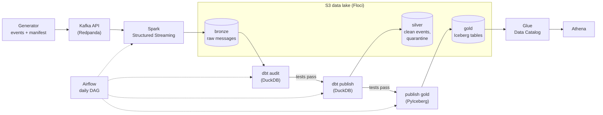

# sme-finance-lakehouse

[](https://github.com/Plouplou37/sme-finance-lakehouse/actions/workflows/ci.yml)

A data platform for a fictional small-business invoicing application, built end to end on one laptop:
events stream through Kafka, Spark lands them in an S3 data lake, dbt turns them into tested tables,
Airflow runs it all every day, and analysts query the result through Glue and Athena.
AWS is emulated locally with Floci: no cloud account, no cost, fake credentials only.

The stack is heavier than this data volume needs, on purpose: the goal is to show how each tool
works, what it guarantees, and when it stops being worth it. Every decision and its limits are
written down in an [architecture decision record](docs/adr/).

## The problem

An invoicing application sends events: customers created or moved, invoices issued, updated or
cancelled, payments received or refunded. Analysts want four answers they can trust:

| Question | Gold table |
|---|---|
| What is the monthly revenue of each company? | `mart_monthly_revenue` |
| Which invoices are unpaid, and how late? | `mart_aged_receivables` (detail in `fct_invoices`) |
| How long do customers take to pay (DSO, days sales outstanding)? | `mart_dso` |
| Which customers pay late most often? | `mart_late_payers` |

The events are not clean, as in real life: duplicates, late arrivals, negative amounts, unknown
currencies, payments for invoices that do not exist, overpayments, and a schema change halfway
through (`payment_method` added in version 2). A [generator](docs/event-contract.md) produces
them from a seed, with a manifest counting every anomaly by type, so the platform can prove it
found each one.

## Architecture



| Step | Tool | What it guarantees | Decision |
|---|---|---|---|
| Run everything | Docker Compose, Make | One command, pinned images, memory caps, no Docker socket | [ADR 0003](docs/adr/0003-docker-compose.md) |
| AWS services | Floci (S3, Glue, Athena) | The same API calls as on AWS; every gap with AWS tested and listed | [ADR 0001](docs/adr/0001-floci.md) |
| Transport | Kafka API, served by Redpanda | Events of one invoice in order (key = `invoice_id`), replay, consumers that resume | [ADR 0004](docs/adr/0004-kafka-redpanda.md) |
| Ingestion | Spark Structured Streaming (`AvailableNow`) | Every message in bronze once, resumable from a checkpoint | [ADR 0005](docs/adr/0005-spark-ingestion.md) |
| Storage | S3 + Parquet, bronze / silver / gold | Raw history kept, columnar reads, one folder per table | [ADR 0006](docs/adr/0006-s3-parquet-medallion.md) |
| Transformations | dbt + DuckDB | Deduplicated, typed, validated data; contracts, reconciliations, quarantine | [ADR 0007](docs/adr/0007-dbt-duckdb.md) |
| Publication of gold | Apache Iceberg, written with PyIceberg | One commit per table, only after every test; a week of history; type changes refused | [ADR 0010](docs/adr/0010-iceberg-gold.md) |
| Orchestration | Airflow | Daily run, retries, replays, backfills, alerts, and no publication if a blocking test fails | [ADR 0008](docs/adr/0008-airflow.md) |
| Consumption | Glue Data Catalog + Athena | Tables by name, built from dbt's contracts; results checked against DuckDB | [ADR 0002](docs/adr/0002-glue-athena.md) |
| Every change | GitHub Actions | Lint, tests and a full dbt build on every pull request; `main` only takes green ones | [ADR 0009](docs/adr/0009-github-actions-ci.md) |

Architecturally this is a lakehouse: open files on object storage, a catalog, SQL engines on top.
Bronze and silver are plain Parquet folders; gold, the layer analysts read, is made of Apache Iceberg
tables, which add atomic commits, history and controlled schema changes. At this volume a single
database would do the job: a lakehouse is a database taken apart, and this project shows each piece
a database hides, and what it costs to run it yourself.

## Results

Measured on the default dataset (5 companies, 90 days, seed 42: 2,578 events, 146 anomalies).

| What | Result |
|---|---|
| Kafka | 2,578 messages acknowledged, matching the manifest; 2,296 keys read back in order; a stopped consumer resumed with no loss |
| Bronze | 2,578 rows, offsets 0 to the last one in each of the 9 partitions, no gap, no duplicate; a crash between write and commit replayed one batch without writing it twice |
| Silver | every event accounted for: 2,578 = valid + 30 quarantined + 59 duplicates; anomalies found = manifest, type by type |
| Gold | reconciled with silver to the cent; 9 tables with enforced contracts, 90 columns described, 5 marked as personal data |
| dbt | 19 models and 54 tests in about 4 s: 72 pass, 1 warning (1.19 % of events quarantined, above the 1 % alert, below the 5 % block) |
| Airflow | 8 tasks per daily run; replays and a 3-day backfill gave the same counts; a stopped broker was retried then recovered; a blocking test left silver and gold untouched |
| Iceberg | 9 gold tables published in one commit each, after every test; during a write, readers kept seeing the previous version; a second, concurrent writer was refused and lost nothing; a type change was refused; a second publication changed nothing but the data's version |
| Athena | the four analyst queries give the same rows through Athena and DuckDB (15, 616, 5 and 161), on the Iceberg tables |
| CI | about 25 s per pull request; a deliberate contract break was blocked from merging |

What the data shows: 616 invoices were unpaid at the end of the period, but most were simply not
due yet (1.5 days late on average), hence ageing buckets rather than "unpaid = late". The bad payers
stand out (71 % to 83 % of their invoices late) although nothing in the data labels them. The
average delay to settle (32 to 38 days) only counts settled invoices and hides the slow ones; the
DSO (37 to 51 days) counts what is still owed.

## Limits

- **An emulator is not AWS.** Floci's Athena runs DuckDB, not Trino: the analysis SQL is written
  to be portable and parses with Trino's grammar, but was never run on Trino. IAM, networking,
  encryption, performance and cost are not tested at all ([ADR 0001](docs/adr/0001-floci.md)).
- **One machine.** One Kafka broker with no replication, Spark in local mode, DuckDB with a
  single writer, one Airflow scheduler: nothing is highly available.
- **Each run reprocesses everything.** Simple and safe to replay at this size. At scale, one day
  per run (date partitions, a window for late events, state tables merged on their key) is the
  target ([ADR 0008](docs/adr/0008-airflow.md)).
- **Atomic per table, not across tables.** Each gold table changes in one Iceberg commit, but the nine
  are published one after the other: for a few seconds, a reader can see a new fact table with the
  previous dimension. Silver is still plain Parquet, written before its own tests run
  ([ADR 0010](docs/adr/0010-iceberg-gold.md)).
- **The CI checks the code, not the day's data or the services.** The Airflow DAG is not loaded
  there, and the sample is the generator's dataset; the data itself is tested by the pipeline at
  each run ([ADR 0009](docs/adr/0009-github-actions-ci.md)).
- **Alerts go to a file,** and nothing alerts when data is late.

## Getting started

### Prerequisites

| Tool | Tested version |
|---|---|
| Docker Desktop (Docker Engine + Compose v2) | Docker 28.3.0, Compose 2.38.1 |
| GNU Make | 3.82.90 |
| uv (Python package and project manager) | 0.8.11 |
| Git | 2.46.0 |

Tested on Windows 10 with Docker Desktop (WSL 2 backend). uv uses an installed Python 3.12 or
downloads one, then installs the exact dependencies from `uv.lock`. No AWS account is needed: the
credentials in `.env.example` are fake.

### Run the whole pipeline

```sh
git clone https://github.com/Plouplou37/sme-finance-lakehouse.git
cd sme-finance-lakehouse
cp .env.example .env                          # fake credentials only (cp also works in PowerShell)
make up                                       # S3 and Kafka, bucket and topics
uv run python -m generator                    # fictional events and their manifest, in data/generated/
uv run --env-file .env python -m producer     # publish them to Kafka (once per dataset)
make pipeline                                 # Airflow and Spark Connect (about 5 GB more memory for Docker)
```

Open Airflow on http://localhost:8088 (`admin` / `admin` by default, set in `.env`) and trigger the
`sme_lake_pipeline` DAG. The first build of the Airflow image takes a few minutes.

```text
check_sources -> ingest_bronze -> dbt_audit -> dbt_publish -> publish_catalog
              -> publish_gold -> check_athena -> run_report
```

Each run writes a report to `data/reports/`, failed attempts to `data/alerts/alerts.log`, and the
dbt catalogue to `data/catalog/`. To see the blocking test stop the publication, trigger the DAG
with `quarantine_error_share` set to `0.005`.

| Command | What it does |
|---|---|
| `make up` | Start S3 and Kafka, create the bucket, its prefixes and the topics. Safe to run again |
| `make pipeline` | `make up`, then Airflow and the Spark Connect server |
| `make down` | Stop every container, keep the data |
| `make reset` | Stop every container and **delete all data**, Airflow's history included |

### Run each step by hand

With `make up` only (no Airflow):

```sh
uv run --env-file .env python -m consumer                                        # read the topics back: counts, order per key
docker compose run --rm spark                                                    # Kafka -> bronze Parquet
docker compose run --rm spark /opt/spark/bin/spark-submit /jobs/check_bronze.py   # check bronze against Kafka
uv run --env-file .env dbt build --project-dir dbt --profiles-dir dbt            # silver and gold, with every test
uv run --env-file .env dbt source freshness --project-dir dbt --profiles-dir dbt # is bronze up to date?
uv run --env-file .env dbt docs generate --project-dir dbt --profiles-dir dbt
uv run --env-file .env dbt docs serve --project-dir dbt --profiles-dir dbt       # catalogue and lineage on http://localhost:8080
uv run --env-file .env python scripts/publish_gold.py --manifest dbt/target/manifest.json    # gold as Iceberg tables in Glue
uv run --env-file .env python scripts/check_athena.py                            # the four queries, Athena vs DuckDB
```

Check the bucket with `docker compose run --rm awscli s3 ls s3://sme-lake/ --recursive`.
Run `uv run python -m generator --help` for every generator option, including one rate per anomaly.

### Run the CI checks locally

The same checks as [ci.yml](.github/workflows/ci.yml), with no Docker and no credentials:

```sh
uv run ruff check .
uv run sqlfluff lint analytics
uv run pytest
uv run python -m generator
uv run python -m generator.local_lake --lake-root data/ci-lake
LAKE_ROOT=data/ci-lake uv run dbt build --project-dir dbt --profiles-dir dbt --target ci   # PowerShell: $env:LAKE_ROOT = "data/ci-lake" first
```

### Data lake layout

```text
s3://sme-lake/
├── bronze/           every Kafka message unchanged (topic=<topic>/ingestion_date=<date>/), written by Spark
├── silver/           clean, typed, deduplicated events per entity, and silver_quarantine/ (rejected events
│                     with their reason), written by dbt, one folder per table
├── gold/             star schema and marts as Iceberg tables (data/ and metadata/ per table), by publish_gold.py
├── checkpoints/      Spark's streaming progress
├── athena-results/   Athena query outputs, kept out of the table folders
├── quarantine/       created in M1, unused: the quarantine is a silver table
└── bench/            reserved for an optional benchmark
```

### Endpoints

| Service | From the host | From containers |
|---|---|---|
| Floci (S3, Glue, Athena) | `http://localhost:4566` | `http://floci:4566` |
| Kafka API (Redpanda) | `localhost:19092` | `redpanda:9092` |
| Schema Registry (Redpanda) | `http://localhost:18081` | `http://redpanda:8081` |
| Airflow (`make pipeline`) | `http://localhost:8088` | `http://airflow-apiserver:8080` |
| Spark Connect (`make pipeline`) | `sc://localhost:15002` | `sc://spark-connect:15002` |

## Progress

- [x] **M0 — Feasibility spike**: Floci emulates S3, Glue and Athena; DuckDB and Spark read and write Parquet on it; Redpanda replaces Floci's Kafka (MSK), which did not survive restarts.
- [x] **M1 — Repository foundations**: one-command environment (`make up`), idempotent bucket setup, no secrets in Git.
- [x] **M2 — Data generator**: reproducible invoice and payment events (`--seed`), with known anomalies and a manifest.
- [x] **M3 — Kafka**: three keyed topics with 3 partitions each; a producer that checks every delivery; a verification consumer.
- [x] **M4 — Spark and bronze**: Kafka to raw Parquet on S3 with Structured Streaming, resumable through checkpoints; crash replay tested.
- [x] **M5 — dbt silver**: typed and deduplicated data; invalid events quarantined with a reason; every bronze event accounted for.
- [x] **M6 — dbt gold**: star schema (invoice and payment facts, customer history as SCD2) and one mart per analyst question.
- [x] **M7 — Data quality**: enforced contracts, reconciliation with the manifest, blocking and warning tests, freshness, documented columns.
- [x] **M8 — Airflow**: daily DAG with retries, replays, a backfill, a publication barrier, alerts and a report per run.
- [x] **M9 — Glue and Athena**: gold registered in Glue from dbt's manifest; the analyst queries checked through Athena against DuckDB.
- [x] **M10 — CI**: GitHub Actions on every pull request, with no service; `main` only accepts green pull requests.
- [ ] **M11 — Documentation**: one ADR per main technology, this README.
- [x] **M12 — Iceberg**: gold published as Iceberg tables in Glue with PyIceberg, after every dbt test; atomic commits, concurrent writers and schema changes tested on Floci first (`spikes/m12/`).

## Documentation

- [docs/adr/](docs/adr/): one decision record per technology (context, decision, what was proven, limits, when not to use it, alternatives)
- [docs/event-contract.md](docs/event-contract.md): the events, their fields and their format
- [docs/journal.md](docs/journal.md): the log of each module, with its success criteria and lessons
- [VERSIONS.md](VERSIONS.md): every pinned version, and why
- [CLAUDE.md](CLAUDE.md): working rules for AI coding agents in this repository
